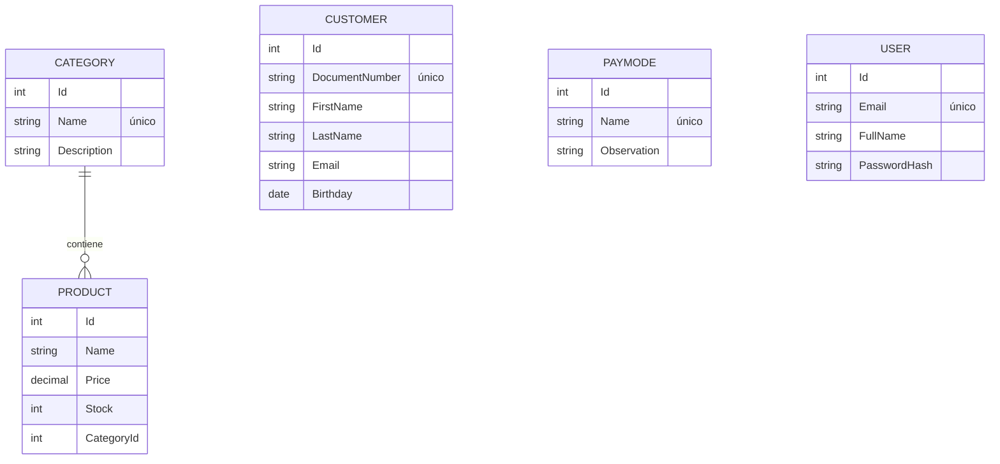

# SupermarketWEB

Aplicación web para la gestión de un supermercado construida con **ASP.NET Core Razor Pages (.NET 10)** y **Entity Framework Core**. Permite administrar categorías, productos, clientes y medios de pago, con autenticación de usuarios y un panel con indicadores del inventario.

## Funcionalidades

- **Autenticación** con cookies: registro, inicio y cierre de sesión. Todas las páginas requieren sesión salvo las públicas.
- **Panel de inicio** con totales, valor del inventario y productos con stock bajo o agotados.
- **Categorías**: CRUD con búsqueda, nombre único y bloqueo del borrado si tienen productos asociados.
- **Productos**: CRUD con paginación, búsqueda, filtro por categoría y por stock bajo.
- **Clientes**: CRUD con paginación, búsqueda por documento, nombre o correo y documento único.
- **Medios de pago**: CRUD con nombre único.
- Interfaz en español, responsiva (Bootstrap 5) y con validación en cliente y servidor.

## Stack

| Capa | Tecnología |
| --- | --- |
| Web | ASP.NET Core 10 · Razor Pages · Bootstrap 5 |
| Datos | Entity Framework Core 10 · SQLite · Migraciones |
| Seguridad | Autenticación por cookies · PasswordHasher (PBKDF2) · Rate limiting |
| Pruebas | xUnit · WebApplicationFactory · SQLite en memoria |

## Puesta en marcha

Requisitos: [SDK de .NET 10](https://dotnet.microsoft.com/download/dotnet/10.0).

```bash
git clone https://github.com/zemogc/SupermarketWEB.git
cd SupermarketWEB
dotnet run --project src/SupermarketWEB
```

La aplicación queda disponible en `http://localhost:5272`. Al iniciar se aplican las migraciones y, si la base está vacía, se cargan datos de ejemplo.

En el entorno **Development** se crea un usuario de demostración:

| Correo | Contraseña |
| --- | --- |
| `admin@supermarket.local` | `Admin123!` |

También puedes crear tu propia cuenta desde **Registrarse**.

## Pruebas

```bash
dotnet test
```

La suite incluye pruebas unitarias y de integración que levantan la aplicación completa en memoria y recorren los flujos reales a través de HTTP: inicio de sesión, protección de páginas, formularios con token antiforgery, validaciones, reglas de negocio y cabeceras de seguridad.

## Estructura

```text
SupermarketWEB/
├── src/SupermarketWEB/
│   ├── Data/              # DbContext, migraciones y datos iniciales
│   ├── Infrastructure/    # Paginación, formato, seguridad y utilidades transversales
│   ├── Models/            # Entidades del dominio con sus validaciones
│   ├── Pages/             # Razor Pages agrupadas por módulo
│   └── wwwroot/           # Recursos estáticos
└── tests/SupermarketWEB.Tests/
    ├── Infrastructure/    # WebApplicationFactory y helpers de HTTP
    └── *Tests.cs          # Pruebas por módulo
```

## Modelo de datos



## Decisiones de diseño

- **Razor Pages con el `DbContext` en cada página.** Para un CRUD de este tamaño evita capas sin lógica propia; las reglas compartidas viven en clases base por módulo (`ProductFormPageModel`, `CustomerFormPageModel`…).
- **Protección contra overposting.** Los formularios usan `TryUpdateModelAsync` con la lista explícita de campos editables.
- **Seguridad por defecto.** Política de autorización global, validación de `ReturnUrl`, cierre de sesión solo por POST, contraseñas con hash, límite de intentos por IP en login/registro, cabeceras `X-Frame-Options`, `X-Content-Type-Options`, `Referrer-Policy` y `Content-Security-Policy` fuera de desarrollo.
- **Cultura.** El binding usa la cultura invariante para que los decimales funcionen igual en cualquier servidor; el formato colombiano (`es-CO`) se aplica solo al mostrar valores.
- **SQLite.** No requiere instalación y facilita clonar y ejecutar. Cambiar a SQL Server solo implica otro proveedor de EF Core y otra cadena de conexión.

## Migraciones

`dotnet-ef` está declarado como herramienta local:

```bash
dotnet tool restore
dotnet ef migrations add NombreDeLaMigracion --project src/SupermarketWEB -o Data/Migrations
```

## Configuración

| Clave | Descripción | Valor por defecto |
| --- | --- | --- |
| `ConnectionStrings:SupermarketDB` | Cadena de conexión SQLite | `Data Source=supermarket.db` |
| `SeedDemoUser` | Crea el usuario de demostración | `true` en Development |
| `RateLimiting:AuthenticationPermitsPerMinute` | Intentos de login/registro por IP y minuto | `5` |
