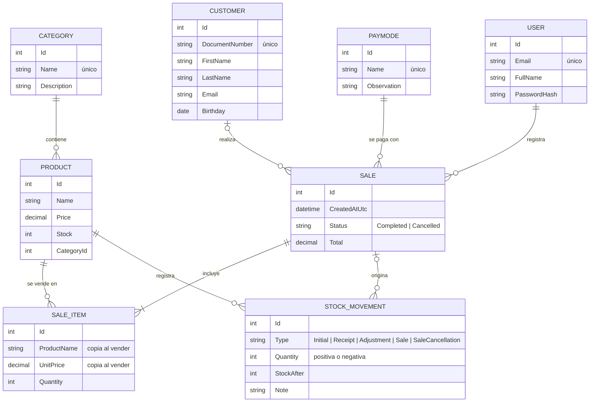

# SupermarketWEB

Aplicación web para la gestión de un supermercado construida con **ASP.NET Core Razor Pages (.NET 10)** y **Entity Framework Core**. Permite registrar ventas con control de inventario y administrar categorías, productos, clientes y medios de pago, con autenticación de usuarios y un panel con indicadores del negocio.

## Funcionalidades

- **Autenticación** con cookies: registro, inicio y cierre de sesión. Todas las páginas requieren sesión salvo las públicas.
- **Roles** de administrador y cajero, con administración de usuarios. Un cambio de rol se aplica de inmediato y cierra las sesiones abiertas del usuario.
- **Ventas**: registro con varios productos, cliente opcional (consumidor final) y medio de pago; descuento automático del stock, comprobante imprimible, anulación con devolución del inventario e historial filtrable por fechas.
- **Inventario (kardex)**: cada cambio de stock queda registrado con su tipo (saldo inicial, entrada, ajuste, venta o anulación), usuario, motivo y saldo resultante. Entradas de mercancía y ajustes por conteo físico con motivo obligatorio.
- **Reportes** (administradores): ingresos, ticket promedio, ventas por día, productos más vendidos y desglose por medio de pago para cualquier rango de fechas, con exportación del detalle a CSV.
- **Panel de inicio** con ventas del día, últimas ventas, valor del inventario y productos con stock bajo o agotados.
- **Categorías**: CRUD con búsqueda, nombre único y bloqueo del borrado si tienen productos asociados. Productos, clientes y medios de pago con ventas tampoco pueden eliminarse, para conservar el historial.
- **Productos**: CRUD con paginación, búsqueda, filtro por categoría y por stock bajo. El stock no se edita a mano: cambia solo con movimientos de inventario.
- **Clientes**: CRUD con paginación, búsqueda por documento, nombre o correo y documento único.
- **Medios de pago**: CRUD con nombre único.
- Interfaz en español, responsiva (Bootstrap 5) y con validación en cliente y servidor.

## Stack

| Capa | Tecnología |
| --- | --- |
| Web | ASP.NET Core 10 · Razor Pages · Bootstrap 5 |
| Datos | Entity Framework Core 10 · SQLite · Migraciones |
| Seguridad | Autenticación por cookies · PasswordHasher (PBKDF2) · Rate limiting |
| Pruebas | xUnit · WebApplicationFactory · SQLite en memoria |
| Despliegue | Docker multi-etapa · Docker Compose · Health checks |

## Puesta en marcha

Requisitos: [SDK de .NET 10](https://dotnet.microsoft.com/download/dotnet/10.0).

```bash
git clone https://github.com/zemogc/SupermarketWEB.git
cd SupermarketWEB
dotnet run --project src/SupermarketWEB
```

La aplicación queda disponible en `http://localhost:5272`. Al iniciar se aplican las migraciones y, si la base está vacía, se cargan datos de ejemplo.

En el entorno **Development** se crea un usuario de demostración:

| Correo | Contraseña |
| --- | --- |
| `admin@supermarket.local` | `Admin123!` |

También puedes crear tu propia cuenta desde **Registrarse**: entrará como cajero, salvo que sea la primera cuenta de una instalación nueva, que queda como administradora.

### Permisos por rol

| Acción | Cajero | Administrador |
| --- | :---: | :---: |
| Registrar y consultar ventas | ✔ | ✔ |
| Anular ventas | | ✔ |
| Consultar productos | ✔ | ✔ |
| Crear, editar y eliminar productos | | ✔ |
| Crear y editar clientes | ✔ | ✔ |
| Eliminar clientes | | ✔ |
| Categorías y medios de pago | | ✔ |
| Administrar usuarios y roles | | ✔ |
| Reportes y exportación CSV | | ✔ |
| Entradas, ajustes e historial de inventario | | ✔ |

### Con Docker

Sin instalar .NET, solo con Docker:

```bash
docker compose up -d --build
```

La aplicación queda en `http://localhost:8080` con el usuario de demostración habilitado. La base de datos y las claves de sesión se guardan en el volumen `supermarket-data`, así que sobreviven a reinicios y a reconstrucciones de la imagen. El contenedor corre con un usuario sin privilegios y expone `GET /health` para monitoreo.

## Pruebas

```bash
dotnet test
```

La suite incluye pruebas unitarias y de integración que levantan la aplicación completa en memoria y recorren los flujos reales a través de HTTP: inicio de sesión, protección de páginas, formularios con token antiforgery, validaciones, reglas de negocio y cabeceras de seguridad.

## Estructura

```text
SupermarketWEB/
├── src/SupermarketWEB/
│   ├── Data/              # DbContext, migraciones y datos iniciales
│   ├── Infrastructure/    # Paginación, formato, seguridad y utilidades transversales
│   ├── Models/            # Entidades del dominio con sus validaciones
│   ├── Pages/             # Razor Pages agrupadas por módulo
│   ├── Services/          # Lógica de negocio que abarca varias entidades (ventas, inventario, reportes)
│   └── wwwroot/           # Recursos estáticos
└── tests/SupermarketWEB.Tests/
    ├── Infrastructure/    # WebApplicationFactory y helpers de HTTP
    └── *Tests.cs          # Pruebas por módulo
```

## Modelo de datos



## Decisiones de diseño

- **Razor Pages con el `DbContext` en cada página.** Para un CRUD de este tamaño evita capas sin lógica propia; las reglas compartidas viven en clases base por módulo (`ProductFormPageModel`, `CustomerFormPageModel`…).
- **Servicio de ventas.** Registrar una venta toca varias tablas, así que vive en `SaleService` y no en la página. Corre dentro de una transacción y descuenta el stock con un `UPDATE ... WHERE Stock >= cantidad`: si dos cajas venden el último producto al mismo tiempo, solo una lo logra y la otra se revierte completa, sin dejar stock negativo. Hay una prueba que simula esa carrera.
- **El stock solo cambia mediante movimientos.** `InventoryService` es el único punto que modifica el stock y siempre deja un `StockMovement`, de modo que la suma de movimientos de un producto es igual a su stock (hay una prueba de ese invariante). Los ajustes por conteo usan concurrencia optimista: si se vendió algo mientras se contaba, el ajuste se rechaza en lugar de borrar esa venta del inventario.
- **Ventas como registro histórico.** Cada línea guarda el nombre y el precio vigentes al vender, así el comprobante no cambia si después se edita el producto. Las ventas se anulan, no se borran.
- **Exportación CSV segura.** Sigue RFC 4180, incluye BOM UTF-8 para que Excel muestre bien las tildes y antepone `'` a los textos que empiezan con `=`, `+`, `-` o `@`, para evitar la inyección de fórmulas al abrir el archivo.
- **Fechas en UTC, días en hora local.** Las ventas se guardan en UTC y los filtros y reportes agrupan por el día local del servidor; `TimeProvider` permite probar esos límites con una zona horaria fija.
- **Protección contra overposting.** Los formularios usan `TryUpdateModelAsync` con la lista explícita de campos editables.
- **Autorización declarativa.** Los permisos por rol se aplican con convenciones de Razor Pages en `Program.cs`, así las reglas quedan en un solo lugar. Cada sesión guarda un sello de seguridad que se valida en cada petición: al cambiar el rol de alguien, sus cookies dejan de servir al instante.
- **Seguridad por defecto.** Política de autorización global, validación de `ReturnUrl`, cierre de sesión solo por POST, contraseñas con hash, límite de intentos por IP en login/registro, cabeceras `X-Frame-Options`, `X-Content-Type-Options`, `Referrer-Policy` y `Content-Security-Policy` fuera de desarrollo.
- **Cultura.** El binding usa la cultura invariante para que los decimales funcionen igual en cualquier servidor; el formato colombiano (`es-CO`) se aplica solo al mostrar valores.
- **SQLite.** No requiere instalación y facilita clonar y ejecutar. Cambiar a SQL Server solo implica otro proveedor de EF Core y otra cadena de conexión.

## Migraciones

`dotnet-ef` está declarado como herramienta local:

```bash
dotnet tool restore
dotnet ef migrations add NombreDeLaMigracion --project src/SupermarketWEB -o Data/Migrations
```

## Configuración

| Clave | Descripción | Valor por defecto |
| --- | --- | --- |
| `ConnectionStrings:SupermarketDB` | Cadena de conexión SQLite | `Data Source=supermarket.db` |
| `SeedDemoUser` | Crea el usuario de demostración | `true` en Development |
| `RateLimiting:AuthenticationPermitsPerMinute` | Intentos de login/registro por IP y minuto | `5` |
| `DataProtection:KeysPath` | Carpeta persistente para las claves de la cookie de sesión | Ubicación del sistema (`/app/data/keys` en Docker) |
| `HttpsRedirection:Enabled` | Redirige HTTP a HTTPS; se desactiva detrás de un proxy con TLS | `true` (`false` en Docker) |

En variables de entorno, `:` se reemplaza por `__` (por ejemplo, `ConnectionStrings__SupermarketDB`).
